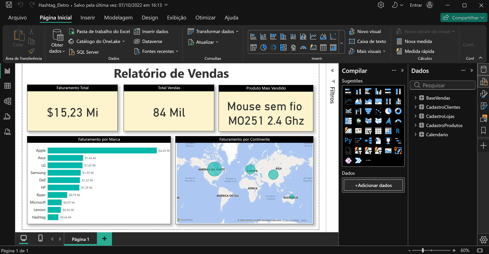

# 📘 Módulo 01 — Importação e Tratamento de Bases de Dados com Power Query

---

## 📌 Contexto do Módulo

Primeiro módulo da trilha Power BI Impressionador, com 37 aulas. Apresenta o Power Query, o editor do Power BI usado para importar, limpar e transformar dados antes de montar relatórios. O módulo parte da importação de uma primeira base, passa pelo tratamento de cadastros e pela resolução dos problemas mais comuns, e avança para mesclar e acrescentar consultas, importar arquivos de uma pasta e criar uma tabela calendário. Fecha com um relatório simples em três partes, o FAQ, um resumo de boas práticas e seis aulas de exercícios.

## 🎯 Objetivo

Desenvolver conhecimentos práticos e operacionais relacionados a:

- Importar bases de dados para o Power BI e tratá-las no Power Query
- Identificar e resolver problemas comuns de importação e erros de atualização
- Combinar bases com Mesclar Consultas e Acrescentar Consultas
- Importar vários arquivos de uma pasta e atualizar o relatório com novos dados
- Criar e configurar uma tabela calendário
- Usar colunas condicionais, ferramentas de texto, ferramentas de data e parâmetros
- Aplicar boas práticas de importação e tratamento
- Construir um relatório simples a partir das bases tratadas

---

## 📂 Estrutura do Módulo

```bash
modulo-01-importacao-e-tratamento-com-power-query/
│
├── Bases/
│   ├── Base_Devoluções.xlsx
│   ├── Base_Funcionarios.xlsx
│   ├── Base_Vendas_-_2020.xlsx
│   ├── Base_Vendas_-_2021.xlsx
│   ├── Base_Vendas_-_2022.xlsx
│   ├── Cadastro_Clientes.xlsx
│   ├── Cadastro_Localidades.xlsx
│   ├── Cadastro_Lojas.xlsx
│   └── Cadastro_Produtos.xlsx
│
├── Relatorios/
│   ├── Hashtag_Eletro.pbix
│   └── Resolução_Exercício_-_Gabarito_Final.pbix
│
├── Material-de-Apoio/
│   └── Importando_e_Tratando_Bases_de_Dados_-_Boas_Práticas.pdf
│
└── Imagens/
    └── hashtag-eletro-relatorio.png
```

---

## 🧠 Conceitos Abordados

### 🔹 Importação e Tratamento de Bases

Importação de arquivos Excel para o Power BI e tratamento no Power Query: tipos de dados, nomes de colunas, remoção de linhas e colunas desnecessárias e tratamento de cadastros (clientes e produtos). Inclui a atualização de uma base com novos clientes.

### 🔹 Problemas Comuns e Erros de Atualização

Problemas frequentes no Power Query e como resolvê-los, além do que fazer quando ocorre erro na atualização da base de dados.

### 🔹 Ferramentas de Texto e Otimização de Etapas

Ferramentas de texto do Power Query, otimização das etapas aplicadas, coluna de exemplos e reordenação de colunas.

### 🔹 Mesclar e Acrescentar Consultas

- **Mesclar Consultas**: combina tabelas por uma coluna em comum, de forma semelhante a um join no SQL
- **Acrescentar Consultas**: empilha tabelas com a mesma estrutura, como as bases de vendas de cada ano
- **Desabilitar Carga**: evita carregar para o modelo consultas que servem apenas de apoio

### 🔹 Importar da Pasta

Importação de todos os arquivos de uma pasta em uma única consulta, e como atualizar o relatório quando chegam novas vendas (2023, 2024 e seguintes).

### 🔹 Tabela Calendário e Ferramentas de Data

O que é uma tabela calendário, por que ela é necessária, como criá-la e como usar as ferramentas de data do Power Query.

### 🔹 Colunas Condicionais, Parâmetros e Atualização

Colunas condicionais para classificar registros por regras, parâmetros no Power Query (por exemplo, para o caminho dos arquivos), configuração de atualizações de consultas e desabilitação de relacionamentos automáticos.

### 🔹 Relatório Simples no Power BI

Construção de um primeiro relatório em três partes, usando as bases importadas e tratadas.

### 🔹 Boas Práticas

- Organizar nomes e formatos antes de importar os dados
- Evitar tabelas desnecessariamente grandes
- Desabilitar a atualização de tabelas que não mudam
- Otimizar as etapas aplicadas
- Criar parâmetros para o caso de o caminho dos arquivos mudar

---

## 🧪 Aplicação Prática (Exercícios)

1. **Bases do curso (Hashtag Eletro)** — nove planilhas usadas ao longo das aulas: vendas de 2020, 2021 e 2022 (2022 vai até 30/06), devoluções (de 2020 a junho de 2022), e os cadastros de clientes, lojas, localidades e produtos, além da base de funcionários. Algumas vêm com cabeçalho fora da primeira linha e colunas vazias, o que exige tratamento no Power Query.
2. **Relatório de vendas (`Hashtag_Eletro.pbix`)** — relatório de uma página construído sobre a tabela de vendas já tratada: cartões de Faturamento Total, Total de Vendas e Produto Mais Vendido, gráfico de barras de faturamento por marca e mapa de faturamento por continente.
3. **Exercício Power Query (aulas 32 a 37)** — resolução com a base de funcionários: cartões de Gasto Salarial Total, Média Salarial e Área com mais funcionários, gráfico de contratações por ano e gráfico de funcionários por área (`Resolução_Exercício_-_Gabarito_Final.pbix`).



---

## 📚 Aprendizados

Ao final deste módulo foi possível desenvolver conhecimentos em:

- Importação e tratamento de bases de dados no Power Query
- Resolução de erros de importação e de atualização
- Combinação de bases com mesclar e acrescentar consultas
- Importação de vários arquivos de uma pasta e atualização com novos dados
- Criação de tabela calendário e uso de ferramentas de data
- Uso de colunas condicionais e parâmetros
- Aplicação de boas práticas para manter consultas leves e fáceis de manter
- Construção de relatórios simples a partir de dados tratados

---

## 🚀 Conclusão

Este módulo estabeleceu a base de dados para toda a trilha: antes de calcular ou visualizar qualquer coisa, os dados precisam estar importados e tratados no Power Query. O próximo passo é o Módulo 02 — Relacionamentos, que conecta as tabelas tratadas em um modelo de dados.
