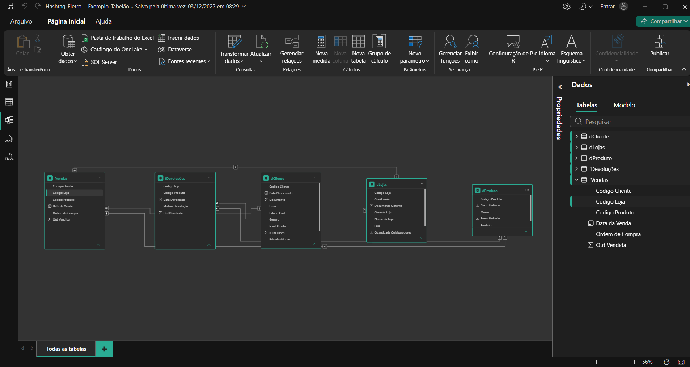

# 📘 Módulo 02 — Relacionamentos

---

## 📌 Contexto do Módulo

Segundo módulo da trilha Power BI Impressionador, com 22 aulas. Depois de importar e tratar as bases no Power Query, este módulo mostra como conectar as tabelas em um modelo de dados. Cobre a diferença entre tabelas fato e tabelas características (dimensões), chaves primárias e estrangeiras, criação de relacionamentos, direção do filtro, cardinalidade e relacionamentos ativos e inativos. Também ensina a investigar valores "em branco" no relatório e a separar uma tabela única ("tabelão") em tabelas fato e dimensão. Fecha com a revisão e as boas práticas.

## 🎯 Objetivo

Desenvolver conhecimentos práticos e operacionais relacionados a:

- Entender quando usar relacionamentos em vez de Mesclar Consultas
- Diferenciar tabelas fato e tabelas características (dimensões)
- Identificar chaves primárias e chaves estrangeiras
- Criar relacionamentos entre tabelas e entender o que eles mudam na prática
- Trabalhar com mais de uma tabela fato no mesmo modelo
- Configurar direção do filtro, cardinalidade e relacionamentos ativos e inativos
- Investigar a causa de valores "em branco" em relatórios
- Separar um tabelão em tabelas fato e dimensão
- Ocultar campos que não precisam aparecer no relatório

---

## 📂 Estrutura do Módulo

```bash
modulo-02-relacionamentos/
│
├── Bases/
│   └── Base_Vendas.xlsx
│
├── Relatorios/
│   ├── Hashtag_Eletro_-_Relacionamentos.pbix
│   └── Hashtag_Eletro_-_Exemplo_Tabelão.pbix
│
├── Material-de-Apoio/
│   └── Criando_Relacionamentos_-_Boas_Práticas.pdf
│
└── Imagens/
    └── modelo-fato-e-dimensao.png
```

> As demais bases usadas nas aulas (vendas por ano, devoluções e cadastros de clientes, lojas, localidades e produtos) são as mesmas do [Módulo 01](../modulo-01-importacao-e-tratamento-com-power-query/Bases).

---

## 🧠 Conceitos Abordados

### 🔹 Relacionamentos x Mesclar Consultas

Quando usar cada abordagem. Relacionamentos mantêm as tabelas separadas e leves, enquanto colunas mescladas aumentam o tamanho da tabela de vendas.

### 🔹 Tabelas Fato e Tabelas Características

- **Tabela Fato**: registra os eventos do negócio, como vendas e devoluções
- **Tabela Característica (Dimensão)**: descreve os elementos dos eventos, como clientes, lojas e produtos
- Como identificar cada tipo e como lidar com mais de uma tabela fato no mesmo modelo

### 🔹 Chave Primária e Chave Estrangeira

- **Chave Primária**: coluna com valores únicos na tabela característica
- **Chave Estrangeira**: coluna com valores repetidos na tabela fato
- Como identificá-las e usá-las para ligar as tabelas

### 🔹 Criando Relacionamentos

Por que as tabelas precisam ser relacionadas, como criar os relacionamentos na visão de modelo e o que muda nos relatórios depois disso.

### 🔹 Direção do Filtro e Cardinalidade

- **Direção do filtro**: o filtro desce das tabelas características para as tabelas fato
- **Cardinalidade**: tipos de relacionamento, como muitos para um
- Por que evitar filtro bidirecional e relacionamentos muitos para muitos, que são exceções

### 🔹 Relacionamentos Ativos e Inativos

Diferença entre relacionamentos ativos e inativos e em que situações cada um é usado.

### 🔹 Valores "em Branco" no Relatório

Por que valores em branco aparecem em visuais e como investigar e corrigir a causa (duas aulas).

### 🔹 Separando o Tabelão em Fato e Dimensão

Passo a passo para quem recebe uma única tabela com tudo:

1. Conectar à fonte de dados (o tabelão)
2. Criar uma cópia da tabela fato para cada dimensão desejada
3. Deletar das cópias as colunas que não interessam
4. Remover as duplicatas
5. Criar uma chave primária (surrogate key) nas dimensões e ligá-la à tabela fato
6. Deletar na tabela fato as colunas que já estão nas dimensões

### 🔹 Ocultando Campos e Boas Práticas

Ocultar campos que não precisam ser usados no relatório, organizar as tabelas características acima das tabelas fato na visão de modelo e manter um modelo organizado e normalizado.

---

## 🧪 Aplicação Prática (Exercícios)

1. **Tabelão de vendas (`Base_Vendas.xlsx`)** — planilha única com 56.046 linhas e 24 colunas, de 01/01/2020 a 30/06/2022, que reúne em cada linha dados da venda, do cliente, do produto e da loja. Serve de ponto de partida para a separação em fato e dimensão.
2. **Modelo com cadastros (`Hashtag_Eletro_-_Relacionamentos.pbix`)** — modelo do projeto Hashtag Eletro com a tabela de vendas reduzida às colunas de data, ordem de compra, SKU, ID do cliente, quantidade e ID da loja, ao lado das tabelas de cadastro de clientes, lojas e produtos e da tabela Calendário. As colunas que vinham de mesclagem no módulo 01 (nome do produto, marca, preço, faturamento, país e continente) deixam de ficar na tabela de vendas.
3. **Modelo fato e dimensão (`Hashtag_Eletro_-_Exemplo_Tabelão.pbix`)** — resultado da separação do tabelão: duas tabelas fato (`fVendas` e `fDevoluções`) e três dimensões (`dCliente`, `dLojas` e `dProduto`), ligadas por cinco relacionamentos muitos para um com filtro em uma direção, usando as chaves `Codigo Produto`, `Codigo Cliente` e `Codigo Loja`.



---

## 📚 Aprendizados

Ao final deste módulo foi possível desenvolver conhecimentos em:

- Escolha entre relacionamentos e Mesclar Consultas
- Identificação de tabelas fato, tabelas características e suas chaves
- Criação e configuração de relacionamentos (direção do filtro, cardinalidade, ativos e inativos)
- Modelagem com mais de uma tabela fato
- Diagnóstico de valores em branco em relatórios
- Separação de um tabelão em tabelas fato e dimensão
- Organização do modelo e ocultação de campos desnecessários

---

## 🚀 Conclusão

Este módulo deu a estrutura do modelo de dados da trilha: tabelas fato e dimensão ligadas por relacionamentos bem configurados deixam os relatórios mais leves e os resultados mais confiáveis. O próximo passo é o Módulo 03 — Funções DAX, que usa esse modelo para criar medidas e cálculos.
