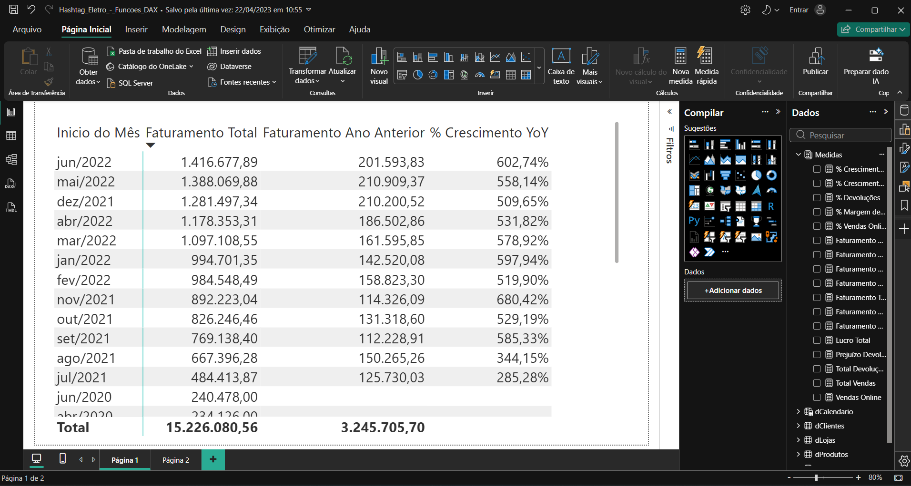

# 📘 Módulo 03 — Funções DAX

---

## 📌 Contexto do Módulo

Terceiro módulo da trilha Power BI Impressionador e o maior até aqui, com 57 aulas. Apresenta o DAX (Data Analysis Expressions), a linguagem de fórmulas do Power BI, sobre o modelo de dados criado no módulo 02. O módulo começa com a diferença entre colunas calculadas e medidas, passa pelos operadores, funções lógicas (IF, SWITCH), matemáticas e de contagem, e avança para CALCULATE, ALL, funções iteradoras (SUMX e similares) e funções de data e inteligência de tempo (acumulados, comparação entre períodos e média móvel). Fecha com as boas práticas.

## 🎯 Objetivo

Desenvolver conhecimentos práticos e operacionais relacionados a:

- Entender as três formas de usar DAX: colunas calculadas, medidas e tabelas
- Diferenciar colunas calculadas e medidas, e quando usar cada uma
- Escrever fórmulas com a sintaxe e os operadores do DAX
- Criar colunas condicionais com IF, IF aninhado e SWITCH, e buscar dados de outras tabelas com RELATED
- Usar funções de soma, média, máximo, mínimo, contagem e divisão
- Alterar o contexto de filtro com CALCULATE e ALL
- Usar funções iteradoras para calcular linha a linha dentro de medidas
- Criar uma tabela calendário com DAX e usar funções de inteligência de tempo
- Organizar medidas e aplicar boas práticas de escrita

---

## 📂 Estrutura do Módulo

```bash
modulo-03-funcoes-dax/
│
├── Relatorios/
│   └── Hashtag_Eletro_-_Funcoes_DAX.pbix
│
├── Material-de-Apoio/
│   ├── Cartilha_Fórmulas_DAX.pdf
│   └── Fórmulas_DAX_-_Boas_Práticas.pdf
│
└── Imagens/
    └── medidas-dax-inteligencia-de-tempo.png
```

> As bases de dados usadas nas aulas (vendas, devoluções e cadastros) são as mesmas do [Módulo 01](../modulo-01-importacao-e-tratamento-com-power-query/Bases).

---

## 🧠 Conceitos Abordados

### 🔹 Introdução ao DAX

- **Colunas Calculadas**: calculadas linha a linha (contexto de linha) e armazenadas na tabela
- **Medidas**: calculadas conforme os filtros do relatório (contexto de filtro) e que não ocupam espaço no arquivo
- **Tabelas**: tabelas criadas a partir de fórmulas DAX
- Recapitulação de colunas calculadas x medidas e por que usar medidas em vez de colunas

### 🔹 Sintaxe e Operadores

Estrutura de uma fórmula (nome, função, tabela e coluna) e operadores matemáticos, de comparação e de texto/lógica (`&`, `&&`, `||`, `IN`).

### 🔹 Funções Lógicas e RELATED

- **IF** e **IF aninhado**, com várias condições (AND e OR)
- **SWITCH** para classificar valores em categorias
- **RELATED** para trazer, de uma tabela característica, uma coluna para a tabela fato
- Colunas no Power Query x colunas em DAX, e cálculo de custo e lucro da venda

### 🔹 Funções Matemáticas e de Contagem

SUM, AVERAGE, MAX, MIN, DIVIDE, COUNT, COUNTROWS e DISTINCTCOUNT, e por que usar medidas e não apenas colunas.

### 🔹 Organização de Medidas e Drill Down

Criação de uma tabela e de pastas para guardar as medidas, e análise com drill down nos visuais.

### 🔹 CALCULATE e ALL

- **CALCULATE**: calcula uma expressão a partir de filtros indicados
- **ALL**: remove filtros, usada, por exemplo, para calcular a participação de cada item no total (% do subtotal)
- Exercícios de ALL e de % do subtotal

### 🔹 Funções Iteradoras

SUMX, AVERAGEX, MAXX, MINX, COUNTX e RANKX: calculam uma expressão linha a linha numa tabela e depois aplicam a agregação, direto dentro de uma medida.

### 🔹 Tabela Calendário e Funções de Data

Criação da tabela calendário com DAX, uso da tabela calendário automática do Power BI e criação dos relacionamentos com as tabelas fato.

### 🔹 Inteligência de Tempo

- **Acumulados**: DATESYTD e TOTALYTD (ano), com mudança de período fiscal, e MTD e QTD (mês e trimestre)
- **Comparação entre períodos**: DATEADD para o mês e o ano anteriores
- **Acumulado de um período**: DATESINPERIOD para os últimos X dias e para a média móvel

### 🔹 Boas Práticas

- Evitar colunas desnecessárias e preferir medidas para os valores dos visuais
- Usar indentação para deixar as fórmulas legíveis
- Seguir para o módulo de DAX Avançado (contexto, variáveis e tabelas virtuais)

---

## 🧪 Aplicação Prática (Exercícios)

1. **Modelo com medidas (`Hashtag_Eletro_-_Funcoes_DAX.pbix`)** — modelo do projeto Hashtag Eletro com as tabelas fato `fVendas` e `fDevoluções`, as dimensões `dClientes`, `dLojas` e `dProdutos`, a tabela `dCalendario` criada com DAX (CALENDAR) e uma tabela `Medidas` que guarda as medidas. Cinco relacionamentos muitos para um com filtro em uma direção ligam as fatos às dimensões.
2. **Colunas calculadas** — `Tipo do Pedido` (IF, pedido único ou múltiplo), `Faixa Etaria` e `Numeração Faixa Etária` (SWITCH sobre a idade do cliente), `Desconto` (SWITCH sobre o nível escolar) e, no calendário, colunas como ano, mês, início do mês, trimestre e `Data Vigente?`.
3. **Medidas (17 no total)**:
   - Básicas: `Total Vendas`, `Total Devoluções` e `% Devoluções`
   - Financeiras (SUMX com RELATED): `Faturamento Total`, `Lucro Total`, `% Margem de Lucro` e `Prejuízo Devoluções`
   - Com CALCULATE: `Vendas Online` e `% Vendas Online` (com DIVIDE)
   - Inteligência de tempo: `Faturamento YTD`, `Faturamento MTD`, `Faturamento QTD`, `Faturamento Mês Anterior`, `% Crescimento MoM`, `Faturamento Ano Anterior` e `% Crescimento YoY`
4. **Relatório** — duas páginas com matrizes por início do mês, mostrando faturamento total, faturamento do ano anterior e crescimento em relação ao ano anterior.



---

## 📚 Aprendizados

Ao final deste módulo foi possível desenvolver conhecimentos em:

- Diferença entre colunas calculadas, medidas e tabelas em DAX
- Criação de colunas condicionais com IF e SWITCH, e uso de RELATED entre tabelas
- Escrita de medidas com funções de soma, contagem, média e divisão
- Controle do contexto de filtro com CALCULATE e ALL
- Uso de funções iteradoras para calcular linha a linha em medidas
- Criação de tabela calendário com DAX
- Análises de inteligência de tempo: acumulados, mês anterior, ano anterior e crescimento percentual
- Boas práticas de organização e escrita de fórmulas

---

## 🚀 Conclusão

Este módulo transformou o modelo de dados em indicadores: com medidas em DAX, o relatório passa a responder perguntas como faturamento, margem, devoluções e crescimento sobre períodos anteriores. O próximo passo é o Módulo 04 — Storytelling, que trata de como apresentar esses números de forma clara e convincente.
