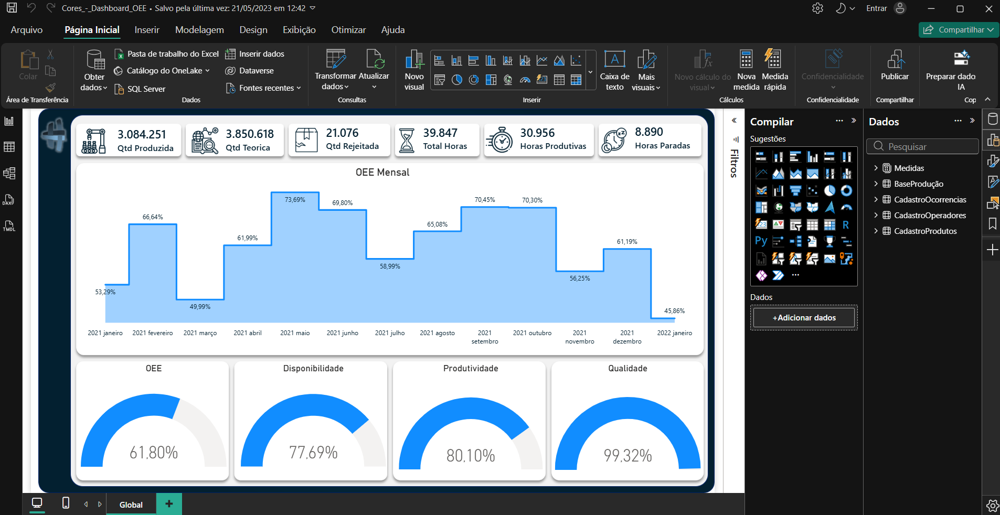

# 📘 Módulo 04 — Storytelling

---

## 📌 Contexto do Módulo

Quarto módulo da trilha Power BI Impressionador, com 12 aulas. Trata de como apresentar dados de forma clara: escolher o gráfico certo para cada pergunta, manter a simplicidade e a organização do painel, cuidar de consistência, contexto, escala e saturação, buscar inspiração e usar ícones, plano de fundo, capa e cores. É o módulo mais conceitual da trilha, com poucos cálculos e foco no visual dos relatórios.

## 🎯 Objetivo

Desenvolver conhecimentos práticos e operacionais relacionados a:

- Escolher o tipo de gráfico mais adequado para cada situação
- Manter relatórios simples, organizados e com leitura fluida
- Garantir consistência de cores, estilos e tamanhos de fonte
- Dar contexto aos gráficos e usar escalas que não distorçam os dados
- Cuidar da saturação para que o plano de fundo não atrapalhe a leitura
- Identificar fontes de inspiração e gráficos que devem ser evitados
- Aplicar ícones, plano de fundo personalizado, capa e paleta de cores

---

## 📂 Estrutura do Módulo

```bash
modulo-04-storytelling/
│
├── Relatorios/
│   ├── Escolha_de_Graficos.pbix
│   ├── Cores_-_Dashboard_OEE.pbix
│   └── Aula_Extra_-_Adendo.pbix
│
├── Material-de-Apoio/
│   └── Storytelling_com_Dados.pdf
│
└── Imagens/
    └── dashboard-oee-cores.png
```

---

## 🧠 Conceitos Abordados

### 🔹 Escolha de Gráficos

Cada tipo de análise pede um tipo de gráfico:

- **Ranking**: gráfico de barras
- **Evolução no tempo**: colunas ou linhas, inclusive comparando duas séries e várias categorias
- **Etapas de um processo**: funil
- **Participação no total**: pizza e rosca
- **Indicador contra uma meta ou percentual**: cartão e medidor
- **Distribuição geográfica**: mapa e mapa preenchido

### 🔹 Simplicidade e Organização

Visualizações simples e claras são mais fáceis de entender. Evitar excesso de cores, efeitos e gráficos na mesma página, usar leitura em Z para posicionar as informações e respeitar alinhamento, espaçamento e ordem dos dados.

### 🔹 Consistência e Contexto

Manter cores, estilos e tamanhos de fonte padronizados e incluir informações suficientes para que o leitor entenda o que está vendo e por que importa.

### 🔹 Escala e Saturação

- **Escala**: deve ser apropriada aos dados. Um eixo que não começa do zero pode exagerar diferenças pequenas e enganar o leitor
- **Saturação**: planos de fundo e cores não podem competir com as informações do painel

### 🔹 Inspiração e Gráficos a Evitar

Onde buscar referências de painéis (sites de design como Dribbble, Pinterest e Behance) e quais tipos de gráfico tendem a atrapalhar a leitura.

### 🔹 Ícones, Plano de Fundo e Capa

Ícones ajudam a comunicar a informação, um plano de fundo personalizado deixa o painel mais atraente e organizado, e uma capa valoriza o relatório.

### 🔹 Escolha de Cores

Como definir as cores principais, criar variações da mesma cor e montar uma paleta harmônica, com o apoio de sites de paletas.

---

## 🧪 Aplicação Prática (Exercícios)

1. **Escolha de Gráficos (`Escolha_de_Graficos.pbix`)** — um relatório de 10 páginas, uma para cada tipo de análise, sobre as tabelas `Vendas`, `Compras`, `Movimentações` e `Projetos`: ranking de faturamento por marca (barras), faturamento por mês (colunas), original x negociado por mês (combinado de colunas e linha), faturamento por tipo de loja (colunas por categoria), oportunidades por status (funil), participação por tipo de venda (pizza), margem (rosca com cartão e medidor), faturamento por continente (mapa) e custo total por região (mapa preenchido). O arquivo traz 7 medidas, entre elas Receita, Despesas, Imposto, Lucro e Margem.
2. **Cores (`Cores_-_Dashboard_OEE.pbix`)** — dashboard de produção com plano de fundo personalizado. Usa a base de produção e os cadastros de ocorrências, operadores e produtos, ligados por 3 relacionamentos, e 10 medidas, como quantidade produzida, horas produtivas e paradas, disponibilidade, produtividade, qualidade e OEE. A página `Global` reúne cartões, um gráfico de área com o OEE mensal e quatro medidores.
3. **Aula Extra (`Aula_Extra_-_Adendo.pbix`)** — relatório de 5 páginas sobre uma base de vendas, com gráfico de barras, linhas por vendedor, gráfico de fita, matriz e um gráfico de cordas (visual personalizado).



---

## 📚 Aprendizados

Ao final deste módulo foi possível desenvolver conhecimentos em:

- Escolha do gráfico adequado para cada tipo de análise
- Organização de painéis com simplicidade, consistência e leitura em Z
- Uso correto de escala, contexto e saturação para não distorcer a informação
- Uso de ícones, plano de fundo personalizado e capa
- Escolha de uma paleta de cores harmônica para o dashboard

---

## 🚀 Conclusão

Este módulo mostrou que um bom relatório depende tanto do visual quanto dos cálculos: o gráfico certo, uma escala honesta e um layout organizado fazem os números serem entendidos. O próximo passo é o Módulo 05 — Dashboard & Visualização de Dados, que aplica essas ideias na construção de dashboards completos.
