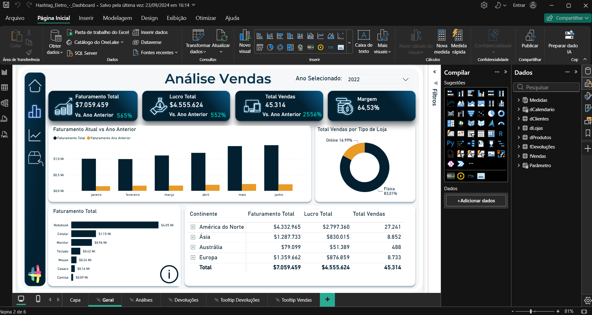
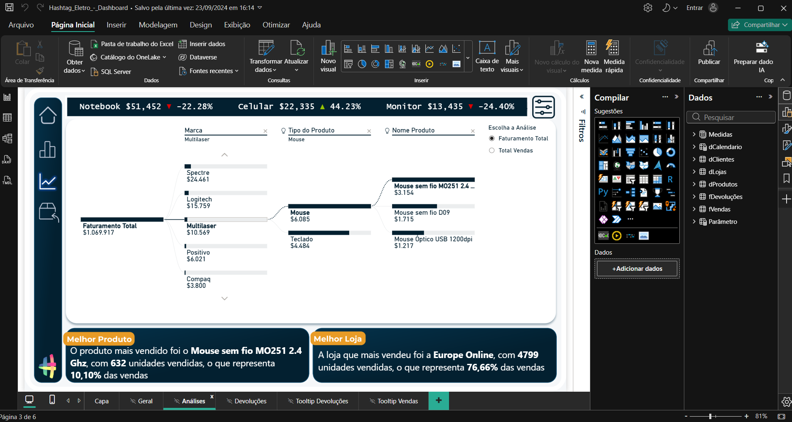
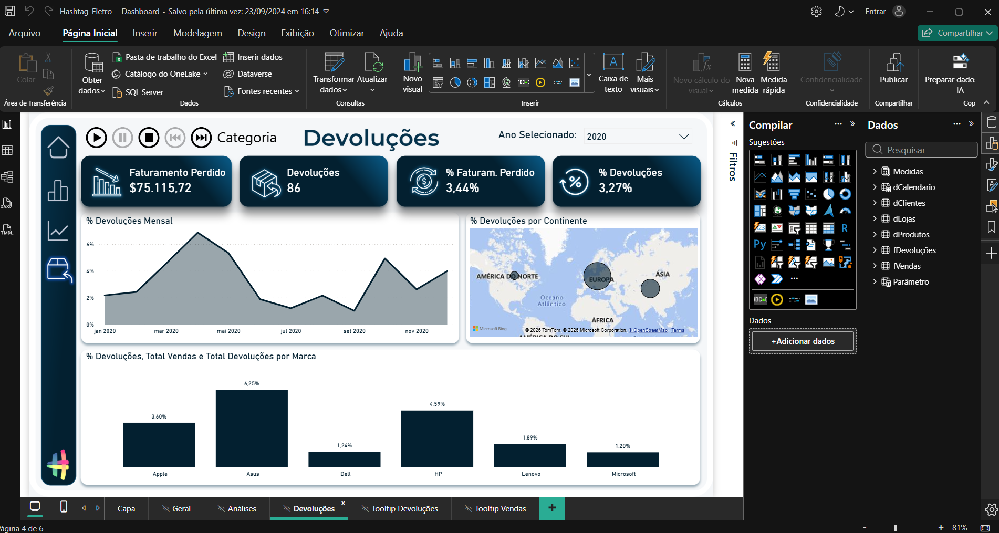
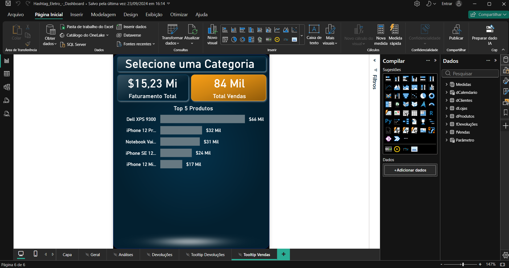

# 📘 Módulo 05 — Dashboard & Visualização de Dados

---

## 📌 Contexto do Módulo

Quinto módulo da trilha Power BI Impressionador, com 50 aulas. É o módulo mais prático da trilha: constrói, do início ao fim, um dashboard completo de vendas e devoluções para a Hashtag Eletro. Parte da definição dos indicadores e do esboço no papel, passa pelo tema, plano de fundo, cartões, gráficos e análises de crescimento, e avança para recursos de interatividade (drill down, sincronização de filtros, edição de interações, Play Axis, tooltips, painéis explicativo e de filtro retrátil). Fecha com a capa e a navegação por hiperlinks entre as páginas.

## 🎯 Objetivo

Desenvolver conhecimentos práticos e operacionais relacionados a:

- Definir os indicadores do dashboard e planejar o layout com esboço e esqueleto
- Aplicar tema, plano de fundo personalizado e capa ao relatório
- Criar cartões, segmentações e análises de crescimento com formatação condicional
- Usar variáveis em DAX e a função TOPN para análises de melhor produto e melhor loja
- Construir visuais de evolução no tempo, pizza e rosca, barras, matriz, árvore de hierarquia, mapa e scroller
- Criar interatividade com botões, marcadores, sincronização de filtros e edição de interações
- Criar tooltips básicos e avançados, e painéis explicativo e de filtro retrátil
- Trazer imagens para o relatório a partir de links e navegar entre páginas com hiperlinks

---

## 📂 Estrutura do Módulo

```bash
modulo-05-dashboard-e-visualizacao-de-dados/
│
├── Bases/
│   └── Base_Imagens.xlsx
│
├── Relatorios/
│   └── Hashtag_Eletro_-_Dashboard.pbix
│
├── Material-de-Apoio/
│   ├── Dashboard.pdf
│   └── Background.pptx
│
└── Imagens/
    ├── dashboard-geral.png
    ├── dashboard-analises.png
    ├── dashboard-devolucoes.png
    └── dashboard-tooltip-vendas.png
```

> As demais bases usadas nas aulas (vendas, devoluções e cadastros) são as mesmas do [Módulo 01](../modulo-01-importacao-e-tratamento-com-power-query/Bases).

---

## 🧠 Conceitos Abordados

### 🔹 Planejamento do Dashboard

Entender os indicadores que se quer apresentar, conversando com quem vai usar o painel, e transformar as perguntas em um esboço no papel e depois em um esqueleto no Power BI. O roteiro do módulo organiza o painel em três áreas: visão geral, análises (melhor produto e melhor loja) e devoluções.

### 🔹 Tema, Plano de Fundo e Cartões

Alteração do tema do relatório, importação do plano de fundo criado fora do Power BI, criação dos primeiros visuais, cartões e segmentação de dados.

### 🔹 Análises de Crescimento

Crescimento de faturamento, lucro e vendas em comparação com o ano anterior, variáveis em DAX, correção de valores "em branco", formatação condicional e o novo visual de cartão do Power BI.

### 🔹 Faturamento ao Longo do Tempo e Outros Visuais

Gráficos de evolução no tempo (com ordenação dos meses), pizza e rosca, barras com Top N, matriz com drill down e árvore de hierarquia.

### 🔹 Melhor Produto, Melhor Loja e Mês Mais Recente

Função TOPN, análise do produto mais vendido, uso do visual Enlighten Data Story para gerar textos automáticos sobre os dados, análise do mês mais recente e gráfico de scroller (barra animada).

### 🔹 Devoluções

Análises de devoluções: faturamento perdido, percentual de devoluções, evolução mensal, mapa por região e drill down.

### 🔹 Interatividade

- **Botão para trocar de análise** automaticamente
- **Sincronização de filtros** entre páginas
- **Edição de interações** entre visuais
- **Play Axis**: filtro dinâmico no dashboard

### 🔹 Tooltips

Dicas de ferramenta básicas e avançadas (páginas de tooltip com cartões e gráficos), inclusive com imagens: criação de links para as imagens (Google Drive e ImgBB), importação da tabela de imagens e uso do visual Simple Image.

### 🔹 Painéis, Capa e Navegação

Painel explicativo e painel de filtro retrátil, capa do dashboard e hiperlinks para navegação entre as páginas.

---

## 🧪 Aplicação Prática (Exercícios)

1. **Roteiro do dashboard (`Dashboard.pdf`)** — passo a passo do módulo: definição dos indicadores, esboço no papel, esqueleto no Power BI e criação do plano de fundo.
2. **Planos de fundo (`Background.pptx`)** — apresentação de 10 slides com o design das páginas do dashboard (capa, análise de vendas, melhor produto e melhor loja, devoluções e tooltips), usada para gerar as imagens de plano de fundo.
3. **Base de imagens (`Base_Imagens.xlsx`)** — tabela com 11 tipos de produto e o link da imagem de cada um, usada nos tooltips. O visual Simple Image não aceita mais links do Google Drive, por isso a base usa links do ImgBB.
4. **Dashboard completo (`Hashtag_Eletro_-_Dashboard.pbix`)** — relatório de 6 páginas sobre o mesmo modelo de dados do módulo 03 (tabelas fato `fVendas` e `fDevoluções`, dimensões `dClientes`, `dLojas` e `dProdutos`, calendário e uma tabela de parâmetro), com 31 medidas e 4 marcadores:
   - `Capa`: botão de entrada para o dashboard
   - `Geral`: cartões, segmentação, gráfico de colunas, rosca, barras, matriz e botões de navegação
   - `Análises`: árvore de hierarquia, visuais Enlighten Data Story, scroller e segmentações
   - `Devoluções`: cartões, gráfico de área, mapa, gráfico de colunas, segmentação e um visual personalizado
   - `Tooltip Devoluções` e `Tooltip Vendas`: páginas de dica de ferramenta, a segunda com imagem do produto









---

## 📚 Aprendizados

Ao final deste módulo foi possível desenvolver conhecimentos em:

- Planejamento de um dashboard, do indicador ao esboço e ao esqueleto no Power BI
- Aplicação de tema, plano de fundo e capa para um visual profissional
- Análises de crescimento com comparação com o ano anterior e formatação condicional
- Uso de TOPN, variáveis em DAX e visuais personalizados, como o Enlighten Data Story
- Interatividade com botões, marcadores, sincronização de filtros, edição de interações e Play Axis
- Criação de tooltips com gráficos e imagens
- Navegação entre páginas com hiperlinks e painel de filtro retrátil

---

## 🚀 Conclusão

Este módulo reuniu tudo o que foi visto até aqui (importação, modelo de dados, DAX e storytelling) em um dashboard completo e navegável. O próximo passo é o Módulo 06 — Criando Layout de Dashboards no PowerPoint, que aprofunda a criação dos planos de fundo usados nos painéis.
