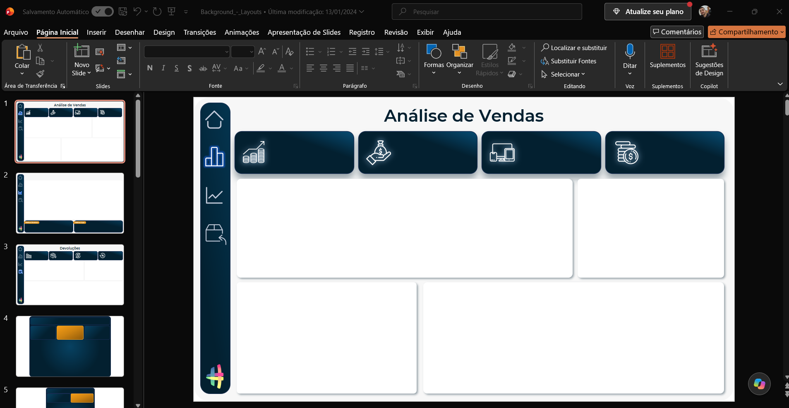
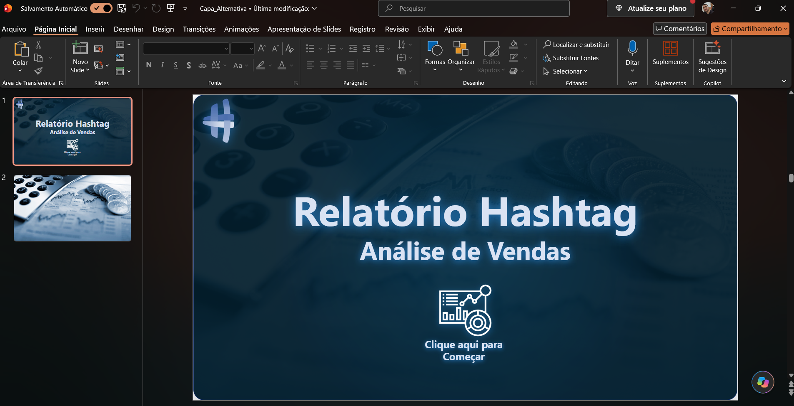

# 📘 Módulo 06 — Criando Layout de Dashboards no PowerPoint

---

## 📌 Contexto do Módulo

Sexto módulo da trilha Power BI Impressionador, com 12 aulas. Mostra como criar, no PowerPoint, os planos de fundo e as capas que dão identidade visual aos dashboards no Power BI. As 11 primeiras aulas constroem, passo a passo, o plano de fundo das páginas do dashboard de vendas e devoluções da Hashtag Eletro, e a última cria uma capa alternativa. Os slides são exportados como imagem e aplicados como fundo das páginas no Power BI, o que o módulo 05 já usou no dashboard completo.

## 🎯 Objetivo

Desenvolver conhecimentos práticos e operacionais relacionados a:

- Criar o layout de um dashboard no PowerPoint, com formas, cores, textos e organização dos blocos de informação
- Montar planos de fundo para cada página do relatório (análise de vendas, melhor produto e melhor loja, devoluções)
- Criar planos de fundo para tooltips e painéis explicativos
- Criar uma capa com botão de entrada para o dashboard
- Criar uma capa alternativa
- Levar as imagens do PowerPoint para o Power BI como plano de fundo das páginas

---

## 📂 Estrutura do Módulo

```bash
modulo-06-layout-de-dashboards-no-powerpoint/
│
├── PowerPoint/
│   ├── Background_-_Layouts.pptx
│   └── Capa_Alternativa.pptx
│
├── Relatorios/
│   └── Hashtag_Eletro_-_Sem_Fundo.pbix
│
├── Bases/
│   └── Base_Imagens_-_Alternativo.xlsx
│
└── Imagens/
    ├── powerpoint-plano-de-fundo.png
    └── powerpoint-capa-alternativa.png
```

> As bases de dados do dashboard (vendas, devoluções e cadastros) são as mesmas do [Módulo 01](../modulo-01-importacao-e-tratamento-com-power-query/Bases), e o dashboard final, com os planos de fundo aplicados, está no [Módulo 05](../modulo-05-dashboard-e-visualizacao-de-dados/Relatorios).

---

## 🧠 Conceitos Abordados

### 🔹 Layout no PowerPoint

Uso do PowerPoint como ferramenta de design: slide em 16:9, que tem a mesma proporção da página do Power BI, com formas, cores e textos para desenhar a estrutura visual do dashboard antes de levá-la ao relatório.

### 🔹 Planos de Fundo por Página

Criação de um plano de fundo para cada página do dashboard: análise de vendas, melhor produto e melhor loja, e devoluções, com os espaços reservados para cartões, gráficos e filtros.

### 🔹 Tooltips e Painéis Explicativos

Planos de fundo para as páginas de dica de ferramenta e para os painéis que explicam como interagir com os gráficos.

### 🔹 Capa e Capa Alternativa

Criação da capa do dashboard, com título e um botão para entrar no relatório, e de uma capa alternativa.

### 🔹 Exportação para o Power BI

Exportação dos slides como imagem e aplicação como plano de fundo das páginas do relatório.

---

## 🧪 Aplicação Prática (Exercícios)

1. **Layouts do dashboard (`Background_-_Layouts.pptx`)** — apresentação de 17 slides com os planos de fundo do dashboard: capa "Dashboard de Vendas" com o botão "Ir para o dashboard", análise de vendas, melhor produto e melhor loja, devoluções e os planos de fundo dos tooltips e do painel explicativo. Contém os slides do módulo 05, e mais alguns slides das etapas de construção.
2. **Capa alternativa (`Capa_Alternativa.pptx`)** — apresentação de 2 slides com a capa "Relatório Hashtag – Análise de Vendas" e o botão "Clique aqui para começar".
3. **Dashboard com planos de fundo anteriores (`Hashtag_Eletro_-_Sem_Fundo.pbix`)** — versão do dashboard do módulo 05, com 6 páginas, 31 medidas e o mesmo modelo de dados, que traz versões anteriores das imagens de plano de fundo.
4. **Base de imagens alternativa (`Base_Imagens_-_Alternativo.xlsx`)** — tabela com 11 tipos de produto e o link da imagem de cada um (ImgBB), usada nos tooltips de vendas.





> Os ícones dos cartões e as demais imagens avulsas do curso não foram incluídos no repositório.

---

## 📚 Aprendizados

Ao final deste módulo foi possível desenvolver conhecimentos em:

- Criação de layouts e planos de fundo de dashboards no PowerPoint
- Planejamento do espaço de cada visual dentro da página
- Criação de capas, tooltips e painéis com identidade visual consistente
- Exportação de slides e aplicação como plano de fundo no Power BI

---

## 🚀 Conclusão

Este módulo mostrou como o PowerPoint pode ser usado para dar uma identidade visual profissional aos dashboards, separando o design do Power BI e deixando o relatório mais organizado. O próximo passo é o Módulo 07 — Power BI Online, que leva os relatórios para o serviço na nuvem.
