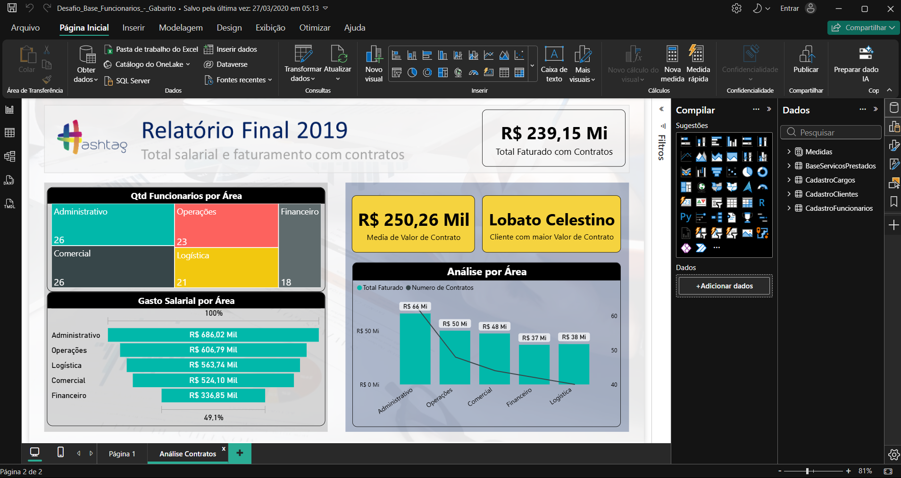

# 📘 Módulo 08 — Exercícios de Revisão

---

## 📌 Contexto do Módulo

Oitavo módulo da trilha Power BI Impressionador, com 15 aulas. É um projeto de revisão: o Desafio Base Funcionários, ou Case Consultoria, em que se analisa uma empresa prestadora de serviços de consultoria. A primeira aula explica o desafio e as outras 14 mostram a resolução passo a passo, reunindo o que foi visto nos módulos anteriores: importação e tratamento no Power Query, relacionamentos, medidas em DAX e construção do relatório.

## 🎯 Objetivo

Desenvolver conhecimentos práticos e operacionais relacionados a:

- Interpretar as bases de dados antes de importá-las para o Power BI
- Importar e tratar tabelas no Power Query (cabeçalhos, colunas vazias, tipos de dados)
- Criar relacionamentos entre tabelas fato e tabelas características
- Calcular tempo de contrato e faturamento com SUMX e RELATED
- Criar medidas com COUNT, DISTINCTCOUNT, AVERAGE, COUNTROWS e CALCULATE
- Criar uma coluna calculada com o gasto salarial total de cada funcionário
- Montar um relatório com plano de fundo, cartões, treemap, funil e gráfico combinado

---

## 📂 Estrutura do Módulo

```bash
modulo-08-exercicios-de-revisao/
│
├── Bases/
│   ├── Base_Servicos_Prestados.xlsx
│   ├── Cadastro_Cargos.xlsx
│   ├── Cadastro_Clientes.xlsx
│   └── Cadastro_Funcionarios.xlsx
│
├── Relatorios/
│   └── Desafio_Base_Funcionarios_-_Gabarito.pbix
│
├── Material-de-Apoio/
│   ├── Projeto_Base_Funcionarios_-_Enunciado.pdf
│   ├── Projeto_Base_Funcionarios_-_Gabarito.pdf
│   ├── PlanoFundo.PNG
│   └── PlanoFundo_-_PPT.pptx
│
└── Imagens/
    └── dashboard-case-consultoria.png
```

---

## 🧠 Conceitos Abordados

### 🔹 Entendendo as Bases

Antes de importar, abrir cada tabela no Excel para entender as informações disponíveis:

- **Cadastro Funcionários**: ID, nome, estado civil, salário base, impostos, benefícios, VT, VR e código do cargo
- **Cadastro Clientes**: ID, nome do cliente e valor do contrato anual
- **Cadastro Cargos**: código do cargo, nível e área
- **Base Serviços Prestados**: funcionário que presta o serviço, cliente que o contratou e data de contratação (todos os contratos seguem vigentes)

### 🔹 Importação e Tratamento

Desativar a criação automática de relacionamentos, renomear as consultas com nomes intuitivos, promover cabeçalhos na base de cargos, excluir colunas vazias e conferir os tipos de dados.

### 🔹 Relacionamentos

Separar tabelas características (em cima) e tabelas fato (embaixo) e criar as relações entre funcionários, cargos, clientes e serviços prestados.

### 🔹 Cálculos

- **Tempo de contrato**: anos completos desde a contratação, calculados no Power Query
- **Faturamento total**: tempo de contrato multiplicado pelo valor anual do contrato, com SUMX e RELATED
- **% de funcionários que já fecharam contrato**: quantidade de funcionários com serviço prestado dividida pela quantidade total
- **Gasto salarial**: coluna com salário base, impostos, benefícios, VT e VR, e total da área administrativa com CALCULATE

### 🔹 Relatório

Plano de fundo de página, cartões, gráfico de árvore (treemap), funil, gráfico combinado de colunas e linha, e cartão do cliente com maior valor de contrato por filtro N superior.

---

## 🧪 Aplicação Prática (Exercícios)

1. **Enunciado e gabarito (PDFs)** — o enunciado passo a passo e o gabarito em slides, com as etapas e as respostas de referência: 87% dos funcionários já fecharam algum contrato, a área de Logística tem o menor percentual (71%) e o gasto salarial da área administrativa é de R$ 686.016,38. O faturamento total (cerca de R$ 221 milhões na época do curso) aumenta com o tempo, porque depende do tempo de contrato.
2. **Bases (Excel)** — 4 planilhas: serviços prestados (237 contratos), cadastro de clientes (320), cadastro de funcionários (114) e cadastro de cargos (25).
3. **Relatório resolvido (`Desafio_Base_Funcionarios_-_Gabarito.pbix`)** — modelo com 3 relacionamentos, 8 medidas e a coluna calculada `Total Gastos Funcionario`, além da coluna `Tempo de Contrato` criada no Power Query. O relatório tem a página `Página 1`, com cartões e uma matriz, e a página `Análise Contratos`, com cartões, treemap, funil e gráfico combinado, sobre o plano de fundo do módulo.
4. **Plano de fundo** — imagem `PlanoFundo.PNG` e o slide de origem (`PlanoFundo_-_PPT.pptx`), com o título "Relatório Final 2019".



---

## 📚 Aprendizados

Ao final deste módulo foi possível desenvolver conhecimentos em:

- Análise prévia das bases antes da importação
- Tratamento de dados no Power Query e criação de colunas de tempo
- Modelagem com tabelas fato e características
- Medidas com SUMX, RELATED, COUNT, DISTINCTCOUNT, AVERAGE e CALCULATE
- Montagem de um relatório completo a partir de um enunciado

---

## 🚀 Conclusão

Este módulo fechou a parte prática da trilha: do tratamento dos dados ao relatório final, o projeto reuniu tudo o que foi visto nos módulos anteriores em um caso do início ao fim. O próximo e último passo da trilha é o Módulo 09 — Conectando o Power BI com Bancos de Dados SQL e Introdução à linguagem SQL.
