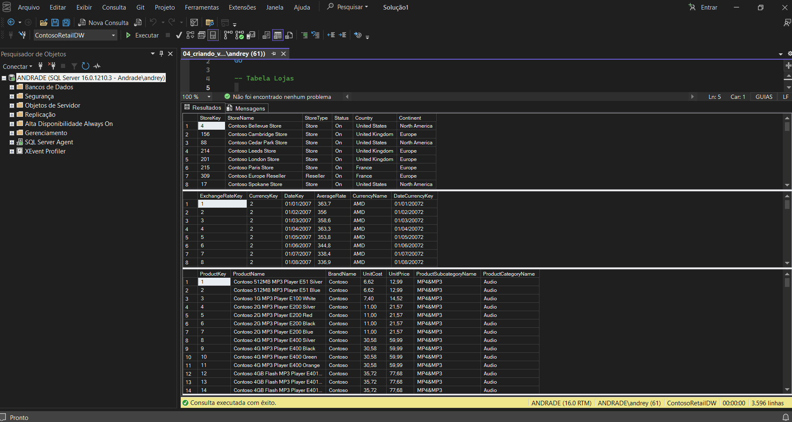
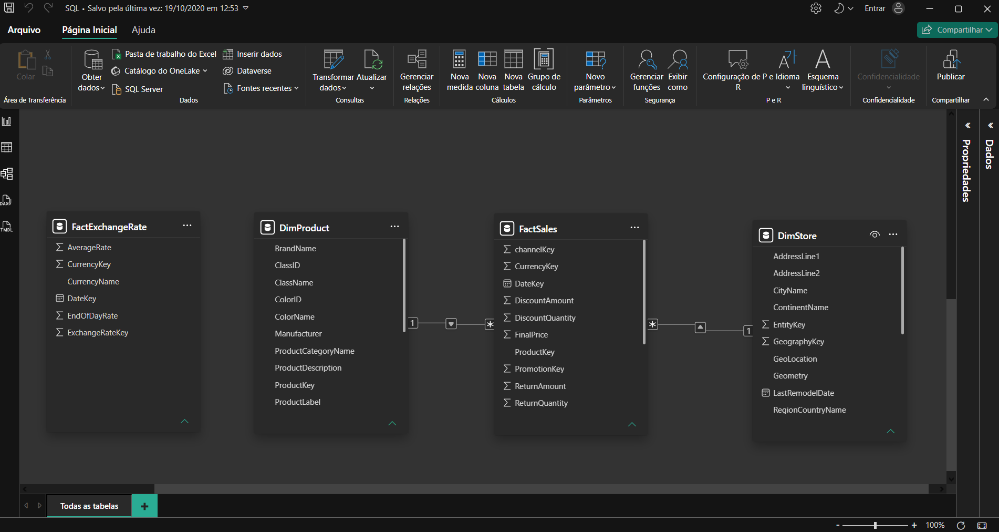

# 📘 Módulo 09 — Conectando o Power BI com Bancos de Dados SQL e Introdução à linguagem SQL

---

## 📌 Contexto do Módulo

Nono e último módulo da trilha Power BI Impressionador, com 36 aulas. Mostra como usar um banco de dados SQL Server como fonte de dados do Power BI e apresenta a linguagem SQL. O módulo começa com a instalação do SQL Server e do SQL Server Management Studio (SSMS) e a restauração do banco de dados, passa pela importação e pelo tratamento das tabelas no Power BI, e depois ensina os comandos básicos de SQL (SELECT, WHERE, GROUP BY, ORDER BY, TOP e JOIN). Fecha usando o SQL para criar as tabelas dimensão e transformar as consultas em views que o Power BI importa.

## 🎯 Objetivo

Desenvolver conhecimentos práticos e operacionais relacionados a:

- Instalar o SQL Server e o SSMS e restaurar um banco de dados
- Importar tabelas do SQL Server para o Power BI e entender a consulta nativa
- Analisar e tratar as tabelas de produtos, lojas, vendas, promoções e cotações
- Escrever consultas básicas em SQL: SELECT, FROM, WHERE com AND e OR, e renomear colunas
- Usar funções de agregação (MAX, COUNT, AVG, DISTINCT), GROUP BY, ORDER BY e TOP
- Combinar tabelas com JOIN
- Criar as dimensões Loja e Produto e a junção de cotações e moedas com SQL
- Criar uma chave em comum entre as tabelas de vendas e cotações
- Transformar as consultas em views e importá-las para o Power BI

---

## 📂 Estrutura do Módulo

```bash
modulo-09-conexao-com-bancos-sql-e-introducao-ao-sql/
│
├── Relatorios/
│   └── Conexao_Power_BI_SQL_Server.pbix
│
├── Queries/
│   ├── 01_select_from.sql
│   ├── 02_select_renomear_colunas.sql
│   ├── 03_chave_cotacoes_e_vendas.sql
│   └── 04_criando_views.sql
│
├── Exercicios/
│   └── 05_gabarito_exercicio_query.sql
│
└── Imagens/
    ├── ssms-consultas.png
    └── power-bi-modelo-sql.png
```

> O banco de dados ContosoRetailDW não está no repositório: ele é restaurado no SSMS na aula 3. A trilha de SQL também usa essa base, e o [Módulo 25 da trilha SQL](../../sql-impressionador/modulo-25-integracao-sql-server-e-power-bi) faz a integração do SQL Server com o Power BI de outra forma.

---

## 🧠 Conceitos Abordados

### 🔹 Instalação e Banco de Dados

Instalação do SQL Server e do SSMS, download do banco de dados e restauração no SSMS, e observações sobre o uso do SQL na empresa.

### 🔹 SQL Server no Power BI

Importação das tabelas do SQL Server para o Power BI, carregamento e consulta nativa, análise das tabelas do banco e tratamento das tabelas de produtos, lojas, vendas e promoções e de cotações.

### 🔹 Comandos Básicos de SQL

- **SELECT e FROM**: selecionar tabelas e colunas específicas, com comentários e renomeação de colunas
- **WHERE**: filtros, com AND e OR
- Exercícios de prática dos comandos

### 🔹 Funções de Agregação e Agrupamento

MAX, COUNT, AVG e DISTINCT, GROUP BY (com e sem WHERE), ORDER BY e TOP.

### 🔹 JOIN

Formas de mesclar consultas (tipos de JOIN) e como usar o JOIN no SQL.

### 🔹 Criando Dimensões e Views

Criação da dimensão Loja (com geografia), da junção de cotações e moedas e da dimensão Produto (com subcategoria e categoria), criação da chave de data e moeda para relacionar cotações e vendas, e transformação das consultas em views importadas para o Power BI.

---

## 🧪 Aplicação Prática (Exercícios)

1. **Power BI conectado ao SQL Server (`Conexao_Power_BI_SQL_Server.pbix`)** — relatório ligado ao banco ContosoRetailDW, com 4 tabelas importadas (`DimProduct`, `DimStore`, `FactExchangeRate` e `FactSales`). No Power Query, o arquivo mescla produto com subcategoria, loja com geografia, cotações com moedas e vendas com promoções, e limita as vendas às 2.000 primeiras linhas. O modelo tem 2 relacionamentos, de `FactSales` com `DimProduct` e com `DimStore`.
2. **Consultas básicas (`01_select_from.sql` e `02_select_renomear_colunas.sql`)** — seleção de todas as colunas e de colunas específicas das tabelas `DimProduct` e `DimStore`, com comentário e renomeação de colunas.
3. **Chave de cotações e vendas (`03_chave_cotacoes_e_vendas.sql`)** — consultas das tabelas de cotações e de vendas, com a data convertida para texto e uma chave que junta data e moeda, para relacionar as duas tabelas.
4. **Dimensões e views (`04_criando_views.sql`)** — consultas das tabelas de lojas (com país e continente), cotações (com o nome da moeda) e produtos (com subcategoria e categoria), que são a base das views importadas para o Power BI.
5. **Exercício (`05_gabarito_exercicio_query.sql`)** — consulta na tabela `DimEmployee` com nome completo, gênero traduzido (REPLACE) e filtro por cargo (gerente regional ou estadual de vendas) e por departamento (Produção ou Marketing).





---

## 📚 Aprendizados

Ao final deste módulo foi possível desenvolver conhecimentos em:

- Instalação e uso do SQL Server e do SSMS
- Conexão do Power BI com um banco de dados SQL Server
- Escrita de consultas SQL com SELECT, WHERE, GROUP BY, ORDER BY, TOP e JOIN
- Criação de tabelas dimensão e de chaves de relacionamento com SQL
- Uso de views como fonte de dados do Power BI

---

## 🚀 Conclusão

Este módulo fechou a trilha Power BI Impressionador, ligando o Power BI a um banco de dados real: em vez de planilhas, os dados vêm do SQL Server, tratados com SQL antes de chegar ao relatório. Com ele, a trilha de Power BI está concluída, e o próximo passo do portfólio é a trilha de Python.
